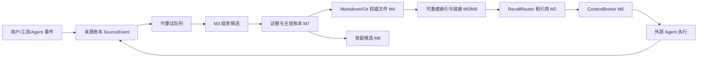

# Atlas 记忆源码调研｜R 总裁决

日期：2026-10-16。分支：`memory-survey`，基于 `origin/memory-survey`。范围：审查 A/B/C 三线并给出后续施工合同；本轮不改 Atlas 实现、不运行测试。

## 审查结论与证据边界

A/B/C 结果已合并。R 抽查 A 10 组、B 8 组、C 8 组具体源码行为；三份结果末尾均附有审查意见。修正涉及许可证、幂等和水位范围、可选执行路径、引用身份歧义及质量门控范围。调查样本不是穷尽所有候选；M3 的 memU 等缺口不当作已核实结论。未运行候选项目或测试。

## 各模块最终选择

| 模块 | 选择 | 强项 | 采用边界 |
|---|---|---|---|
| M1 生命周期 | Hermes `memory_provider.py` / `memory_manager.py` 作事件模型；Claude hooks、OpenClaw 插件作接线参照 | turn、pre-compress、session-end、delegation 覆盖 | Atlas 统一编排；hook 只触发事件，不决定提交水位 |
| M2 原文指针 | Atlas `session_sync.py:message_uid` 为规范身份；Codex rollout/citations、AMA `traj_get/traj_find` 作查询参考 | 精确定位消息与工具步骤 | 引用键含 conversation/trajectory + message_uid/span；身份进入签名与检索 |
| M3 提炼 | Mem0 ADD-only 候选提取 + Mastra Observer 结构化 observation | 增量提取、有限已有记忆上下文、结构化结果 | Mem0 hash 只覆盖 top-10 召回和当前 batch；全局幂等由 Atlas 来源键承担。支持工具观察和模型推断，不只接受用户原话 |
| M4 整合 | Codex Phase 2 lease/diff/retry/watermark + OpenClaw host-side plan/lineage/exact-match | 控制闭环与并发编辑保护 | 模型只提案；host 重读文件并检查 hash/generation 后原子应用。Basic Memory core 为 AGPL，不安排直接复制 |
| 透明库 | Atlas Markdown/Git 权威源；借 Codex baseline diff、OpenClaw 精确内容校验、Basic Memory reconcile 行为 | 可读可改、审计恢复、索引可重建 | 不照搬 Basic 的 DB-first accepted-write 顺序；文件提交成功后再推进派生状态 |
| M5 召回 | Atlas RecallRouter，结合 Mem0 hybrid/rerank fallback、Claude-Mem 分层下钻、Codex citations/usage、mnemostack 有界 retry 思路 | 小摘要、按需取证、引用和采用反馈 | retry 限次且可配置；无 seed 安全回退。Supermemory 公开代码是远端客户端，不是后端算法 |
| M6 委派 | Hermes `on_delegation` + Atlas ContextBroker | 派发前注入、执行中取忆、完成后收回 | Atlas 唯一长期记忆主体；外部 Agent 可执行但不能直接写 canonical store |
| M7 变化事实 | Graphiti 双时间/边失效规则 + Atlas 来源等级和纠正账本 | 同时表达有效时间与记录时间，保留取代关系 | 不引入图服务；时间解析保存原文和置信度；遗忘沿派生链传播 |
| M8 技能晋升 | MemOS eligibility/verifier/lifecycle + SkillOpt staging validation | 候选、验证、晋升分层 | 与长期记忆分开；默认要求 aggregate validation 严格优于 baseline，默认不自动 adopt。SkillOpt 可配置关闭 gate，Atlas 不继承此放宽 |
| M9 联想 | A-MEM 关联提案 + HippoRAG 2 seed-weighted PPR + Markdown `[[links]]` | 显式链接与图扩展结合 | 不引入图数据库；空 seed 安全回退、限深限量；关联不改写事实 |

多模态仅预留字段：modality、raw pointer、time range、region/segment pointer、device/app/source metadata。本轮不采集、不识别、不施工。

## Claude 骨架裁决

骨架成立，但要补充控制与证据契约。保留两阶段提炼/整合、Hermes 生命周期、透明 Markdown/Git、来源等级和页面 `[[链接]]`。提炼范围扩展到工具观察、经验与模型推断；来源等级为用户陈述 > 工具观察 > 模型推断，冲突时决定当前裁决，但低等级原始证据保留。整合器不得直接覆盖整页，必须提交增量 plan，由 host 校验当前文件版本、旧内容和 lineage。以 `(source_event_id, extractor_version)` 做幂等提交。委派权不转移记忆主权。召回应可下钻原文并记录实际采用/反馈。

许可边界：Basic Memory pinned core `a72751c5…` 为 AGPL-3.0-or-later，只作行为参考，或待许可审查后另行决定；Supermemory `skills/` 子目录为 Apache-2.0；Screenpipe 自定义商业许可，不复制代码。

## 一套系统的数据与生命周期

`SourceEvent` 标识会话、消息、tool call 或委派结果，含精确指针、来源等级、observed/valid time、payload hash、处理状态和预留 modality fields。提炼结果是带来源引用、置信度、valid time、recorded time、supersedes/retracts 和 lineage 的 Claim/Experience/TaskState 候选。来源唯一键为 `(source_event_id, extractor_version)`。只有结构校验通过且 Markdown patch 原子提交成功，才提交此来源版本；消息缓存成功不等于记忆提交。

Markdown 是人可编辑的权威呈现；Git 用于变更审计和恢复，不代替来源级删除账本。整合前读取 baseline，plan 带 old hash/lineage；应用前重读 current file。版本或旧内容冲突时保留用户文本，写入可见冲突/重试项，不自动覆盖。SQLite、FTS、向量和关联索引都能从已提交文件重建，不能反向改写权威文件。

读取采用短总览导航、hybrid search、按需原文下钻；结果返回 claim ID、来源引用和排序原因。记录曝光、打开引用、采用、显式反馈及任务 outcome。未采用不删除事实。可选的 query reformulation 限次且不放松权限/时间过滤。

每轮前召回，轮后采集；压缩前、会话结束、工具连续失败、子 Agent 完成也触发钩子。hook 只投递 durable job。ContextBroker 按 scope 注入和提供运行时 search/read，记录审计；外部 Agent 结果作为观察/推断来源返回，经 M3/M7 才能进入规范记忆。

## 与 GPT V4.2 A0–A7、Claude M1–M8 对应

| 本裁决 | GPT V4.2 | Claude |
|---|---|---|
| 盘点基线 | A0 | — |
| SourceEvent、精确指针、队列 | A1/A2 | M2/M3 |
| 生命周期 | A2/A4 | M1/M6 |
| 提炼和证据事实 | A1/A2 | M3/M7 |
| 整合、透明文件和保护手改 | A2 | M4 |
| 召回与引用反馈 | A3 | M5 |
| 委派 | A4 | M6 |
| 时间、纠错、遗忘 | A5 | M7 |
| 技能候选 | A6 | M8 |
| UI/未来跨设备字段 | A7 | M1/M2（仅预留） |
| 联想 | A3 的证据关联 | M4/M5 的 `[[links]]` |

GPT A0 是后续施工前置；A7 UI 与跨设备实现不属于本次范围。模块施工顺序：A0 基线 → M2 → M1/M3/M7 并行 → M4；M5/M9 在 M2 后并行；M6 依赖 M1/M2/M5；M8 依赖 M3/M4/M7。每份任务书列明文件所有权。

## 需用户拍板

1. 是否永远只将 Basic Memory core 作行为参考，或另行审查 AGPL 对 Atlas 分发的影响。本任务书默认不复制。
2. 同等级事实冲突的规则，以及时间新旧与用户纠正之间的精确优先顺序。
3. 用户遗忘后允许保留何种最小 tombstone 以阻止重导入；实施前需按隐私边界决定。
4. M9 默认可选轻量 PPR；若真实使用未证明收益，是否保留传播排序。

## 交付边界

本轮只完成源码审查、总裁决和施工任务书；没有实现记忆功能，没有运行项目或测试，没有声称性能提升。

SURVEY VERDICT DONE
