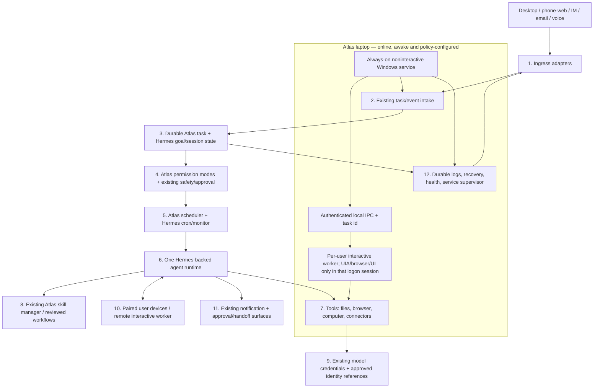

# X7 architecture: always-on personal Atlas on its own laptop

Research date: 2026-10-03. X7 is an Atlas-owned Windows laptop acting as a cloud-VM-equivalent host: it owns a persistent workspace and approved identities, stays reachable when powered and online, and accepts work from the user's other devices. Windows hardware still cannot execute while asleep, powered off, disconnected, or blocked before an interactive login. X7 must surface those states instead of implying guaranteed availability.

## Product evidence distilled from the X7 product comparison

The product comparison is maintained by the parent agent in `07-x7-products.md`; this architecture records only implications that affect implementation.

- A “personal agent on a computer” combines persistent identity and background execution. The reviewed products split these between vendor cloud computers, local companion apps, and device-resident agents; do not infer equivalent Windows unattended execution from a Mac or cloud offering.
- Claude Cowork scheduled/background work is cloud-side; access to local files depends on a connected/local application. Perplexity's 24/7 personal computer claim is for its Mac offering; its Windows page is not evidence of identical Windows background behavior. Manus Cue invites a user to connect personal email/phone/wallet/computer. These differences make Atlas's laptop plus phone/web/IM ingress a coherent design, with the laptop's actual power and logon state explicit.
- Microsoft's Windows Services documentation says services are noninteractive by default; the service runs separately from the logged-in user's desktop. Therefore privileged/always-on control and visible UIA/foreground interaction need separate service and per-user worker processes, joined by authenticated local IPC and durable task ids.
- `SetThreadExecutionState` can request that the system remain awake for work, but it does not override a user closing the lid or the system sleeping. X7 must document and verify an owner-enabled AC/lid policy; it cannot promise wake-on-LAN unless the actual laptop/firmware/network supports and is configured for it.

Official Windows references: [Interactive Services](https://learn.microsoft.com/en-us/windows/win32/services/interactive-services), [SetThreadExecutionState](https://learn.microsoft.com/en-us/windows/win32/api/winbase/nf-winbase-setthreadexecutionstate).

## Source evidence and versions

| Source | Commit / date | License | Files and use |
|---|---|---|---|
| Atlas checkout `sol/x-prep` | `9e6d6fde949a0f581ba7e0031004b1f6c4fdd2f4` / 2026-10-02 | Atlas repository license | `core/atlas/server.py`; `core/atlas/capabilities/durable/dbos_backend.py`; `core/atlas/scheduler/__init__.py`; `core/atlas/engine/session_sync.py`; `core/atlas/agent/__init__.py`; `core/atlas/agent/subagent_worktree.py`; `core/atlas/task_artifacts.py`; `core/atlas/skills/__init__.py`; `core/atlas/skills/registry.py`; `core/atlas/models/credentials.py`; `core/atlas/capabilities/computer/*`; `core/atlas/capabilities/browser/*`; `core/atlas/notifications/*`; `core/atlas/telegram.py` |
| Atlas Hermes fork | `e287231d7906bcce5bc373d20fb2e3e1e6427220` / 2026-10-02 | MIT; fork `unicorn-Y/hermes-agent`, upstream remote `NousResearch/hermes-agent` | `hermes_cli/goals.py`; `hermes_state_sessions.py`; `hermes_state_compression.py`; `hermes_state_gateway.py`; `hermes_cli/gateway_windows.py`; `hermes_cli/service_manager.py`; `hermes_cli/gateway_supervised_restart.py`; `gateway/run_goals.py`; `gateway/slash_commands_goals.py`; `cron/monitor.py`; `cron/scheduler.py`; `cron/scheduler_detached_worker.py`; `skills/` |
| Fresh Hermes upstream comparison clone | `84892e5bd6652f7b04f3a76366d78953fe81ee68` / 2026-10-02 | MIT | `D:/Atlas-x-prep-sources/HermesAgentUpstream`; exact files above |
| OpenClaw | `331a6f0d1d262dcc7bdfb23c94f9b0a97ae9a5fa` / 2026-10-02 | MIT | `D:/Atlas-x-prep-sources/OpenClaw`; inspect gateway lifecycle, cron, device pairing and skill workshop only as comparison; no runtime port |
| OpenAI Codex | `50b4c5e58c1b89f3d1b74155cc1cc1716c2be208` / 2026-10-02 | Apache-2.0 with component-specific licenses | `D:/Atlas-x-prep-sources/Codex/codex-rs/windows-sandbox-service/src/service.rs`; `codex-rs/windows-sandbox-service/src/service/runtime_lifecycle.rs`; compare service lifecycle/isolation boundary only, not an agent host |

## Architecture diagram

## Layer mapping: existing authority, missing glue, wave

| # / layer | Atlas already has | Hermes already has | Direct source / exact files to carry forward | Thinnest Atlas connection and gap | Wave |
|---|---|---|---|---|---|
| 1. Ingress | FastAPI endpoints and `core/atlas/telegram.py`; server starts Telegram service in `core/atlas/server.py` | gateway adapters and goal commands: `gateway/run_goals.py`, `gateway/slash_commands_goals.py`, `hermes_state_gateway.py` | Reuse Hermes connector/channel code selected by X1 and Atlas existing endpoint contracts | Keep one ingress path into existing task/session IDs; add a laptop-owner remote route only through X1 channel gateway. | X1; X6 for voice |
| 2. Event bus | API/task callbacks and `core/atlas/engine/session_sync.py`; `core/atlas/lsp/eventlog.py` is an LSP event log, not a replacement global bus | gateway/session event persistence in `hermes_state_gateway.py` | Hermes `hermes_state_gateway.py` plus existing Atlas callback/event contracts | Map events into task and goal lifecycle; do not claim `lsp/eventlog.py` is already the global event bus. | X1, X3 |
| 3. Durable task/goal state | `core/atlas/capabilities/durable/dbos_backend.py` DBOS workflow; `core/atlas/scheduler/__init__.py`; `core/atlas/server.py:415+` calls Hermes GoalManager as sole goal authority; `core/atlas/engine/session_sync.py` synchronizes outcomes/events | `hermes_cli/goals.py`; `hermes_state_sessions.py`; `hermes_state_compression.py` has cross-process turn leases and fencing/ownership | Reuse these sources as-is through the pinned Hermes fork; don't add a parallel goal/task/session DB | Bridge DBOS durable task id to Hermes goal/session id consistently; verify status/lease/recovery on restart, including stale holder refusal. | X1 + C1 runtime prerequisites; X7 |
| 4. Policy/autonomy | `core/atlas/agent/__init__.py` supports `full_access`, `ask_writes`, `read_only`, subagent permission inheritance/tightening; `core/atlas/engine/hermes_policy.py`; `core/atlas/engine/tool_permissions.py`; `core/atlas/safety/policy.py` | Hermes tool checks in the vendored runtime; goal continuation uses the same session policy | Do not transplant OpenClaw/Codex policies. Keep Atlas policy files | Map intent/action to existing Atlas mode and action safety rules: auto → existing allowed action under inherited mode; ask → existing approval callback; forbid → existing denial/read-only/safety denial. Add explicit action rules only where the current policy lacks them; do not add another mode or policy store. Spend, external send/publish, destructive/irreversible, account/security changes require ask/forbid per existing policy and owner settings; presence-required actions require live interactive worker. | X7; X1 for external actions |
| 5. Scheduler/monitor | `core/atlas/scheduler/__init__.py` cron/interval/date/event and callback; scheduler initialization in `server.py` | `cron/scheduler.py`, `cron/monitor.py`, `cron/scheduler_detached_worker.py`; monitor hashes stable output and suppresses agent execution on no change | Keep Hermes monitor behavior: source check and stable hash before model work. Fresh comparison clone path in `D:/Atlas-x-prep-sources/HermesAgentUpstream/cron/monitor.py` | Reconcile scheduling through current Atlas scheduler callback and Hermes goal execution. A repeated identical monitor source must produce zero model calls; fetch failure remains error/unknown, never “no change”. | X7; X1 event sources |
| 6. Agent runtime | `core/atlas/agent/__init__.py`, `core/atlas/engine/hermes_runtime.py`, `core/atlas/server.py` | `gateway/run_goals.py`, `hermes_cli/goals.py`, and existing runtime | Preserve the single Hermes-backed execution path | Windows service owns startup, health, queue bridge and restart; it submits work to the one existing backend/runtime. Never create a second daemon runtime. | X7 after C1 |
| 7. Tools / computer / browser | `core/atlas/tools/local_execution.py`; `core/atlas/capabilities/computer/{uia_backend.py,cua_backend.py}`; `core/atlas/capabilities/browser/{__init__.py,browser_use.py}` | Hermes tool registry / computer-use tools in `D:/hermes-agent` | Atlas computer/browser capability implementations remain the tool adapters; X2 determines profile and handoff behavior | Split service-safe background tools from UIA/foreground tools. Interactive worker reports online/locked/logged-out; UI tools require matching live user session. Browser profile ownership and login are X2/X1 prerequisites. | X2 |
| 8. Skills/workflows | `core/atlas/skills/__init__.py` `SkillManager`; `core/atlas/skills/registry.py` sole registry; skill lifecycle files; `server.py` registers sources | Hermes skills are an opt-in source under `extensions.hermes_skills`; goal run loads skills in runtime | Use Atlas C4 registry and approved X4 workflow; Hermes skill source only under current opt-in boundary | Demonstration/repeated success creates a candidate via X4/X5 approval. Atlas registry remains sole authority; no runtime-generated auto-enable. | X4, X5 |
| 9. Identity/credentials | `core/atlas/models/credentials.py` and ModelManager credentials; task profiles in `core/atlas/task_artifacts.py` are agent/task profiles, not email/account identities | Hermes profile config and channel identity code; gateway identity files | Use X1 connector auth lifecycle and OS credential protection. No source demonstrates a general Atlas-owned personal identity vault today. | Add references to credentials, not secret values, to task context. Create dedicated Atlas browser/email/messaging identities only via X1-approved connector lifecycle; do not store raw secrets in goal/task rows. | X1, X2 |
| 10. Devices | Atlas current desktop/server/Telegram surfaces; no verified durable device pairing/trust inventory in the inspected paths | Hermes gateway channel/device state; OpenClaw repository has device pairing and node/gateway control surfaces | OpenClaw `src/infra/*`/`src/gateway/*` selected by X3 source map, Hermes gateway state | X3 supplies pairing/trust/online state and remote worker discovery. Don't treat LAN reachability as trust. | X3 |
| 11. Notification/handoff | `core/atlas/notifications/__init__.py`, `core/atlas/notifications/apprise.py`, Telegram service | Hermes goal status notices in `gateway/run_goals.py`, channel delivery in `cron/scheduler_delivery.py` | Keep task id and approval reference across notification/return handoff | Send status, approval request, and completion over unified X1 channels; resume same durable task/session after user response, never create a duplicate goal by default. | X1, X3, X6 |
| 12. Observability/recovery | DBOS durable workflow and Atlas structured server/task results; `core/atlas/capabilities/durable/dbos_backend.py` | `hermes_cli/service_manager.py`, `hermes_cli/gateway_windows.py`, `hermes_cli/gateway_supervised_restart.py`; goal/session/lease state and cron run data | Hermes Windows gateway lifecycle is the concrete same-platform source; OpenAI Codex `codex-rs/windows-sandbox-service/src/service/runtime_lifecycle.rs` is a separate sandbox service example, not an agent daemon | Add Windows SCM service health/restart wrapper and authenticated service↔interactive worker health handshake around Atlas's current server/runtime. Persist execution before IPC, use fencing before resuming, expose offline/locked/sleep/update/crash as distinct statuses. | X7 after C1; X3 for remote status |

## Windows operating model

- Always-on service: starts at boot under an explicitly chosen least-privilege service identity; handles health, durable queue wakeup, scheduler coordination, network reconnect, and restart recovery. It runs noninteractive and cannot drive the signed-in desktop.
- Interactive user worker: starts at user logon, owns UI Automation, foreground windows, user browser profile, and any action requiring an unlocked desktop. It connects through authenticated local IPC and receives only a task id plus bounded capability request. On logoff/lock/worker loss, mark UI-bound work waiting for presence; service-safe tasks may continue.
- Power: on AC, the owner may opt into a Windows power/lid policy that avoids sleep. On battery, follow configured policy. `SetThreadExecutionState` is only an idle-sleep request and does not override lid close or OS policy. Sleep/offline means no execution until resume/reconnect. Wake-on-LAN is conditional on laptop firmware, NIC, router and power state.
- Updates: apply in a maintenance window through a service-owned restart sequence; write checkpoint/lease state before stopping; on boot confirm base/profile/schema, reclaim only expired/dead leases, and resume from durable workflow. Never replay an irreversible external action without idempotency/reconciliation.
- Identity: dedicated Atlas browser profile, email and messaging identities are explicit X1/X2 setup products, not fabricated by X7. Keep credentials in the approved credential provider; tasks store identity references and scope only.

## Required X7 work and file-level implementation order

1. Reconfirm Atlas base and Hermes pin at start: `core/pyproject.toml`, `docs/plan/VENDORED.md`, Hermes Git SHA. Stop on unresolved mismatch; do not rewrite provenance during X7 without an authorized C1 fix.
2. Document service-safe versus interactive-only capability classification in the X7 module boundary; use existing Atlas capabilities and permission callbacks.
3. Add Windows service lifecycle/health wrapper around the existing server/runtime, inspired by Hermes `hermes_cli/gateway_windows.py` and `service_manager.py`. The service wrapper may supervise and bridge; it must not own a new agent/session/scheduler/skills authority.
4. Add the interactive user worker entry point and authenticated local IPC contract. Include worker id, user SID, logon session, task id, expiry, requested capability, approval reference, heartbeat and disconnect state. Reject replayed/expired requests and never allow worker-supplied permission escalation.
5. Wire durable DBOS task id → existing Atlas/Hermes goal/session id through `server.py` and `engine/session_sync.py`. Use existing Hermes lease/fencing; worker loss must not create concurrent goal continuations or overwrite a newer owner.
6. Add explicit lifecycle and recovery transitions using existing durable task/event record paths: queued, leased, running, waiting_for_user, waiting_for_network, paused_for_sleep, awaiting_approval, completed, failed, recovery_required. Keep a mapping at the API boundary if Atlas/Hermes current enums differ; do not create an independent persisted lifecycle.
7. Expose host state and user handoff through the existing notifications and X1/X3 ingress; leave dashboards to X3. Don't trigger a model call just to poll health or unchanged monitor output.
8. Implement owner-facing setup for service startup, worker startup/logon, service identity, network and AC/lid settings, update/restart window, and remote access/pairing. Display an honest unavailability reason and last-seen timestamp.

## Data and events

Reuse DBOS durable task payload and Hermes goal/session/lease rows. Add only required service-worker heartbeat and IPC request fields through the existing runtime/task schema after schema review: service instance id, worker instance id, Windows SID/logon-session id, heartbeat, capability class, task id, lease/fence version, last lifecycle state, OS/network/power observation time, and recovery reason. Never persist raw credentials or full private desktop content as liveness metadata.

Emit/reuse durable task lifecycle events: `host.service.started|stopped|restart_requested|healthy|unhealthy`; `worker.online|locked|logged_out|heartbeat_lost`; `task.waiting_for_user|waiting_for_network|paused_for_sleep|resumed|recovery_required`; `monitor.unchanged|changed|failed`; `approval.requested|granted|rejected`; `handoff.created|accepted|expired`. A no-change event is cheap metadata only; do not invoke the model to narrate it.

## Fake and real-world acceptance

Fake acceptance: service start/stop/restart preserves same DBOS task id and Hermes goal/session; kill service during a fake resumable step then recover once; expired worker lease is fenced and stale worker writes are rejected; network loss/reconnect preserves work; worker locked/logged-out is rejected for interactive action but not for service-safe timer; source hash unchanged produces `monitor.unchanged` and zero model calls; changed source produces exactly one run; no duplicate after restart; restrictive child permission cannot exceed parent; ask/forbid maps to current Atlas approval/deny path; no new scheduler/session/skill registry exists.

Real-world acceptance: on a dedicated Windows test laptop/user profile with fake model and isolated Atlas data, verify boot start, logged-out service health, logon worker registration, locked/unlocked behavior, lid-close and sleep reality on AC/battery, network disconnect/reconnect, forced service crash/restart, remote update/restart, notification/handoff from the user's phone or X1 test channel, dedicated browser/account isolation after X1/X2 setup, and recovery without duplicate outbound actions. Record Windows version, service identity, power source/lid policy, network, worker session state, fake provider trace, task/session ids and exact failures. No claim of universal wake-on-LAN; record hardware support separately.

## Backend, frontend, result, CORE-PARITY and sequencing

- Backend first: service supervisor + authenticated interactive-worker bridge + durable task/session mapping. No UI is required to prove these invariants.
- Frontend: X7 displays service/worker online state, last heartbeat, power/network/logon limitation, task status and explicit handoff/approval; build the product surface in X3/X1, not a second X7 dashboard.
- Proposed CORE-PARITY rows: `X7-windows-service-worker-separation`; `X7-durable-resume-fenced-goals`; `X7-monitor-no-change-zero-model`; `X7-power-network-state-honest`; `X7-owned-identity-reference-only`.
- Dependencies: C1 pin/session/runtime acceptance; X1 connectors and channel gateway; X2 authenticated persistent browser/computer profile; X3 device pairing and remote handoff; X4 single skill/workflow registry; X5 reviewed skill candidate flow; X6 voice ingress where used. X7 can implement host lifecycle and fake-model worker bridge after C1 without waiting for all remote surfaces.
- Blockers: current service/worker startup contract and service identity; interactive worker IPC trust design; unresolved C1 Hermes pin or leases; no test laptop/power conditions; missing user-approved account/connector setup. Report `PARTIAL`/`BLOCKED` on affected acceptance; don't infer availability.
- Result: `tasks/results/ATLAS-X7-ALWAYS-ON-PERSONAL-AGENT.result.md`.
- Scope: this is a future X7 implementation taskbook. It authorizes no production code changes as part of X-PREP.

