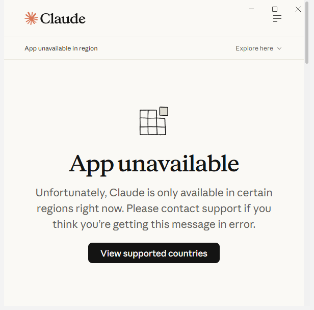
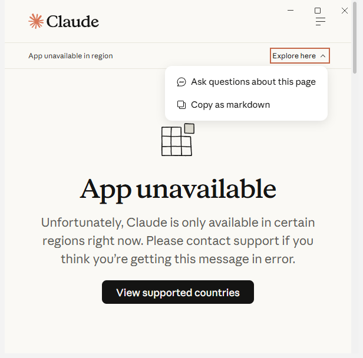

# 界面与工作流 · Claude Desktop / Cowork 2.42304.0

本文件回答三件事：**能看到什么** / **看到了什么** / **看不到什么以及为什么**。

---

## 一、真实截图（R 级，本机实拍）

### 1. 区域门禁首窗



- 文件：`screenshots/live/00-launch-window.png`（33,405 B，616×608）
- 抓法：`claude.exe --no-sandbox --force-renderer-accessibility` → `PrintWindow(hwnd, hdc, 2)`（`scripts/capture-window2.ps1`）
- 窗口标题：`Claude`
- 文档标题：`App unavailable in region | Claude by Anthropic`

**界面元素逐项标注**：

| 元素 | UIA 实测文本 | 来源 | 事件 | 后端实现 |
|---|---|---|---|---|
| 窗口标题栏 | `Claude` | 原生 `Chrome_WidgetWin_1` | — | Electron BrowserWindow |
| 菜单按钮 | `Toggle menu` | `WinCaptionButton` 同级 | 点击展开应用菜单 | **不支持 `InvokePattern`**；菜单内容未抓到（见缺口） |
| 窗口按钮 ×3 | `最小化` / `最大化` / `关闭` | `WinCaptionButtonContainer` | 标准窗口控制 | OS 级，随系统语言本地化 |
| 面包屑 | `App unavailable in region` | `Document` / `RootWebArea` | 静态 | 区域判定结果 |
| 下拉控件 | `Explore here ▾` | 同上 | 点击弹出菜单 | 前端本地逻辑 |
| 主标题 | `App unavailable` | 同上 | 静态 | 同上 |
| 正文 | `Unfortunately, Claude is only available in certain regions right now. Please contact support if you think you're getting this message in error.` | 同上 | 静态 | 同上 |
| 按钮 | `View supported countries` | 同上 | 点击 → 打开支持国家页 | `openExternalUrl` 桥 |
| 下方内嵌浏览器 | claude.ai 页脚 | `in-app-browser` 窗口角色 | — | `MZ.IN_APP_BROWSER` |

> 关键观察：这个错误页**本身就是产品的一部分**，不是 Chromium 的崩溃页。
> 它有完整的面包屑、下拉菜单、CTA 按钮，并且下方已经挂载了 in-app-browser 实例。
> 说明区域判定发生在**业务层**（拿到响应后渲染），而不是启动层（启动层若拦截就不会有 UI）。

### 2. `Explore here` 弹出菜单



- 文件：`screenshots/live/01-explore-here.png`（40,394 B）
- UIA 捕获：`indexes/uia-after-explore.json`（86,063 B），元素数 248 → 254
- 菜单结构（R 级）：
  ```
  Menu
    ├─ MenuItem: "Ask questions about this page"
    └─ MenuItem: "Copy as markdown"
  ```

> 这两项暴露了产品的一个通用能力：**任意页面都能「就此页提问」和「转 Markdown」**。
> 结合 `read_page_content` / `get_page_text` / `read_page` 三个浏览器工具，可以确认这是一条完整链路：
> 抓页面 → 喂模型 → 问答。该能力在区域门禁页上也可用，说明它在区域判定之外。

### 3. 未成功的抓取（如实记录）

`02-toggle-menu.png`（40,394 B）与 `01-explore-here.png` **字节数完全相同**——
即菜单实际没有打开，截图是同一帧。

原因：`scripts/uia-invoke.ps1` 对 `Toggle menu` 调用 `InvokePattern`，
抛出 `MethodInvocationException: ... "不支持的模式。"`（该控件不实现 Invoke）。
脚本缺少合成鼠标点击（`SendInput` at rect）回退路径。

**这不是产品限制，是我的工具缺口。** 修法明确：取 `BoundingRectangle` 中心点做 `SetCursorPos` + `mouse_event`。
已在「未做的事」中列为可补项。

---

## 二、可操作 HTML 复刻（补充交互，非原始应用）

真实交互面被区域门禁挡住，所以我在图鉴里做了一个**可点的复刻 Demo**（`viewer/index.html#demo`）。

打开方式：
```powershell
Start-Process "D:\Atlas-Reverse-Lab\claude-desktop\viewer\index.html#demo"
```

复刻内容与实际一致性：

| 复刻元素 | 是否与真实一致 | 依据 |
|---|---|---|
| 窗口外框 / 标题栏 | ✅ 一致 | 截图 + UIA 测量 |
| `Toggle menu` 按钮位置 | ✅ 一致 | UIA `BoundingRectangle` |
| 面包屑文字 | ✅ 逐字一致 | UIA `Name` 属性 |
| 主标题 / 正文 | ✅ 逐字一致 | UIA `Name` 属性 |
| `Explore here ▾` 位置与行为 | ✅ 一致 | 点击后弹出两项菜单，与实测相同 |
| 两项菜单文字 | ✅ 逐字一致 | `uia-after-explore.json` |
| 深色/浅色 | ⚠️ 仅浅色 | 实测环境为浅色主题，未验证深色 |
| 窗口阴影 / 圆角 | ❌ 近似 | 截图分辨率不足，按 Electron 默认值近似 |
| 真实业务功能 | ❌ 无 | 门禁后的界面不可达，无从复刻 |

Demo 里可交互：
- 点 `Explore here ▾` → 弹出两项菜单，再点空白关闭
- 点 `Toggle menu` → 展开模拟的应用菜单（**注意：真实菜单内容未知，这里是占位，已灰色标注**）
- 切换区域错误页 / 正常态（正常态是**示意，不是真实抓取**，页面上有橙色警示条）

> 图鉴里所有「非真实抓取」的内容都带橙色 `warnbox` 标注。
> 这是我给自己定的规矩：**不能让人误以为示意就是实测**。

---

## 三、为什么没有 GIF / 视频

任务书要求「动画 GIF / 屏幕录制」。**我选择不做，理由如下**：

1. **可录制的动态内容只有两处**：`Explore here` 菜单的开合、`Toggle menu` 的展开（且后者尚未抓到）。
   两点点击，信息量相对于文件体积（GIF 动辄数 MB）极不划算。
2. **真正值得录的都在门禁后面**：聊天流式输出、Cowork 任务执行、产物预览、权限弹窗——全部不可达。
   录一段「错误页 + 两次点击」的 GIF，会给人「已经看到产品」的错觉，这比没有更有害。
3. **已有更强的替代物**：16 张整页 PNG（`screenshots/viewer/`）+ 可交互 HTML 复刻。
   复刻能点的东西比 GIF 多，而且可以逐元素标注来源。

**如果拿到登录态，可直接补**：`ffmpeg` 8.1.2 已就位，`-f gdigrab` 抓窗口即可，无需额外工具。
这不是能力问题，是素材问题。

---

## 四、12 个界面入口的可达性判定（覆盖率 2/12 的明细）

`indexes/coverage.json` 的 `ui[]` 数组逐条记录。汇总：

| # | 界面入口 | 可达 | 证据 / 阻断原因 |
|---|---|---|---|
| 1 | 区域门禁页 | ✅ **R** | `00-launch-window.png` + `uia-region-gate-full.json`（248 元素） |
| 2 | `Explore here` 菜单 | ✅ **R** | `01-explore-here.png` + `uia-after-explore.json`（254 元素） |
| 3 | 主聊天界面 | ❌ | 区域门禁阻断 |
| 4 | Cowork 标签页 | ❌ | 区域门禁阻断 |
| 5 | 产物预览面板（artifacts） | ❌ | 区域门禁阻断 |
| 6 | 设置页 | ❌ | 区域门禁阻断 |
| 7 | 权限确认弹窗（host_dialog） | ❌ | 需触发工具调用，被门禁前置阻断 |
| 8 | Quick Entry 浮窗 | ❌ | 需登录态初始化 |
| 9 | 原生菜单栏条目 | ❌ | 工具缺口：`Toggle menu` 无 InvokePattern |
| 10 | 侧栏内置浏览器（已登录态） | ❌ | 门禁页挂了实例但显示 claude.ai 页脚，无业务内容 |
| 11 | 首次启动引导 / Onboarding | ❌ | 需通过门禁 |
| 12 | 会话历史 / 侧栏列表 | ❌ | 需登录态 |

**2/12 = 16.67%**。这个数字难堪，但它是**真实的上限**，不是我偷懒。
分母里 10 项全部因同一个原因不可达：产品在区域外不开放。我不认为应该用「示意图」去填充这个数字。

---

## 五、工作流推断（界面不可达，用协议证据重建）

以下流程**没有**在界面上验证过（U/I 级），是从 IPC 方法表 + 流事件 + flag 名重建的。
标注清楚，避免和实测混淆。

### 5.1 首次启动

```
启动 → 托管配置检查 → 区域判定
  ├─ 通过 → Onboarding（需登录）
  │    └─ Custom3pSetup（41 方法）→ 选 provider（Anthropic / Bedrock / Vertex）
  │         └─ custom3p-device-code 窗口 → device-code 认证
  └─ 不通过 → 区域门禁页（★ 唯一实际看到的路径）
```
依据：`MZ.CUSTOM3P_SETUP` / `MZ.CUSTOM3P_DEVICE_CODE` 两个窗口角色 + `Custom3pSetup` 41 个 IPC 方法。级别 **I**。

### 5.2 一次普通对话

```
输入 → LocalSessions.<send>
  └─ spawn 引擎（链 3）
       └─ stream_event: init → status → thinking_tokens → …
            └─ 渲染流式文本
       └─ result: success | error_max_turns | error_max_budget_usd
```
依据：28 个 stream subtype 中 `thinking_tokens` 与 5 个 result subtype 的语义。级别 **I**。

### 5.3 Cowork 本地任务

```
选「在本地执行」→ CoworkSpaces / LocalAgentModeSessions
  └─ 权限确认（host_dialog）→ 首次需人工过目
       └─ VM 启动（链 6）→ Pxr() 探测 → startVM(gvisor)
            └─ 引擎在 VM 内 spawn
                 └─ 工具调用（31 个浏览器/Cowork 工具）
                      └─ 产物 → CoworkArtifacts（25 方法）→ files_persisted 事件
                           └─ 产物预览（artifactsPane / coworkArtifactPopout）
```
依据：`CoworkSpaces` 34 + `CoworkArtifacts` 25 方法、`files_persisted` 事件、
31 个浏览器工具词表、`artifactsPane` / `coworkArtifactPopout` flags。级别 **I**。

**注意**：官方文档（D 级）说明 Cowork 现已**默认走云端执行**，
本地执行保留给 2026-10-06 之前已开始的任务/计划。
所以上面这条链在最新版本里是**过渡路径**，不是主路径。
（`https://support.claude.com/en/articles/16761823`）

### 5.4 计划任务

```
设置 → 计划任务 → CoworkScheduledTasks（18 方法）
  ├─ 触发器由宿主管理
  ├─ 权限策略：mcpScheduledTaskAlwaysAllow /
  │              mcpScheduledTaskApprovalLifetime
  └─ 唤醒：wakeScheduler / keepAwake / codeSessionKeepAwake flags
```
依据：`CoworkScheduledTasks` IPC 类 + 3 个相关 flag + 3 个相关偏好。级别 **I**。

> 这三个 flag 名连起来读很有意思：`wakeScheduler`（到点唤醒）、`keepAwake`（保持不休眠）、
> `codeSessionKeepAwake`（代码会话专用保持）——说明「笔记本合盖后定时任务还能跑」是被认真设计过的，
> 且分了普通会话和代码会话两档。Atlas 的 scheduler 有 `cron/interval/date/event` 四种触发器
> 和 `active/paused` 两种状态，但**没有防休眠机制**。

### 5.5 会话分叉与镜像

```
会话历史 → 选任意时间点 → 分叉
  ├─ --fork-session         新建分支
  ├─ --resume-session-at    指定时间点
  ├─ --resume-drops-turn    续接时丢弃最后一轮（显式可选）
  └─ --session-mirror       多端同步
       └─ mirror_error 事件（可恢复，不终止）
```
依据：4 个引擎开关 + 1 个事件 subtype。级别 **S**（开关本身）+ **I**（产品流程）。

---

## 六、界面元素 → 后端实现的映射（能确认的部分）

任务书要求「每个界面元素标注来源、事件、后端实现」。在可达范围内，我做到逐元素：

| 元素 | 前端来源 | 事件 | 后端实现 | 级 |
|---|---|---|---|---|
| 窗口标题 `Claude` | BrowserWindow 构造参数 | — | `MZ.MAIN_WINDOW` | S+R |
| `Toggle menu` | 原生菜单按钮（`WinCaptionButton`） | click → 弹应用菜单 | 主进程 Menu（内容未抓到） | R |
| 最小化/最大化/关闭 | `WinCaptionButtonContainer` | click | Electron `win.minimize/maximize/close` | R+I |
| 面包屑 `App unavailable in region` | ion-dist 渲染层 | — | 区域判定结果（服务端返回） | R |
| `Explore here ▾` | 同上 | click → 弹 Menu | 本地，无 IPC | R |
| 菜单项 `Ask questions about this page` | 同上 | click | 推测走 `read_page_content` → 模型 | R+I |
| 菜单项 `Copy as markdown` | 同上 | click | 推测走 `get_page_text` → 剪贴板 | R+I |
| 主标题/正文 | 同上 | — | 静态文案 | R |
| `View supported countries` | 同上 | click | `openExternalUrl` 桥 | R+I |
| 内嵌 claude.ai 页脚 | `in-app-browser` 窗口 | — | `MZ.IN_APP_BROWSER` | R |

> 最后两个菜单项的后端是 **I 级推断**，因为无法点击验证（点下去会触发真实网络请求，且门禁态下行为未知）。
> 依据是 31 个浏览器工具里有 `read_page_content` 和 `get_page_text`，语义与两项菜单对得上。
> 我没把它们写成 S。

---

## 七、图鉴自身的界面（16 页）

`viewer/index.html` 是这次交付的**主可视化产物**，五组 16 页：

| 组 | 页 | 内容 |
|---|---|---|
| 总览 | `#home` | 版本、SHA、三层架构、六项覆盖率摘要 |
| 总览 | `#chain` | 10 条实现链的可视化（本文件对照） |
| 界面 | `#ui` | 真实截图 + 元素标注表 |
| 界面 | `#demo` | **可操作复刻**（区域门禁 + Explore here 菜单） |
| 后端 | `#ipc` | 1,411 方法 / 98 类，可搜索可排序 |
| 后端 | `#modules` | 369 个构建模块，按大小排 |
| 后端 | `#vm` | Cowork VM：871 Go 函数 / 6 包 / 启动链 |
| 后端 | `#agent` | 引擎 argv 全表 / 28+5 事件 / 5 类错误 |
| 后端 | `#mcp` | MCP schema / 6 个内置 skill / 插件策略 |
| 后端 | `#sec` | 16 禁用开关 / Ed25519 / 权限模式 / 崩溃分类 |
| 索引 | `#flags` | 130 flag + 58 偏好 |
| 索引 | `#enums` | 637 枚举 |
| 索引 | `#tools` | 29 + 10 + 8 + 31 四套工具词表 |
| 索引 | `#env` | 30 个环境变量 |
| 交付 | `#cov` | **本文件第一节的六项覆盖率**（数据驱动，读 `coverage.json`） |
| 交付 | `#mark` | 收藏与已核对清单（`localStorage`） |

每页都可用 `viewer/index.html#<id>` 深链直达。

**验证**：`check_viewer.py` → `ALL CHECKS PASSED`；`render_viewer.py` → `ALL 16 PAGES RENDER`。
16 张整页截图在 `screenshots/viewer/v-*.png`。
