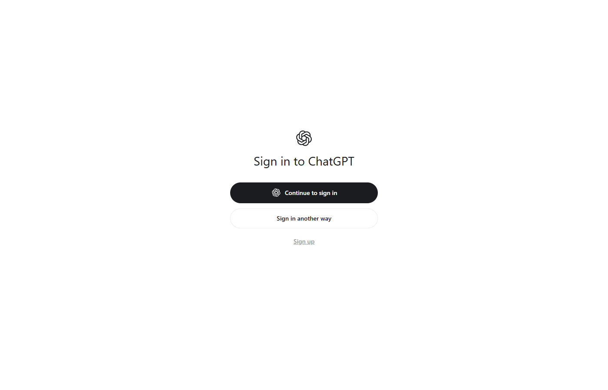

# UI 图鉴（UI Gallery）

## 已获取的真实截图

所有截图均来自**自建解包副本**（`extracted/desktop-msix/app/ChatGPT.exe`），使用全新 `--user-data-dir` 与空 `CODEX_HOME` 启动，不含任何个人账号数据。

### 1. 登录页



- 文件：`screenshots/100_extracted_signin.png`
- 分辨率：1400×900（CDP `Emulation.setDeviceMetricsOverride` 设定）
- 元素：ChatGPT logo、`Sign in to ChatGPT`、`Continue to sign in`（主按钮）、`Sign in another way`、`Sign up`
- 隐藏元素：右上角 `aria-label="Play Snake"` 的彩蛋按钮（36×36，视觉上不可见）
- 证据等级：**R**（实际运行）
- 复现：解包 `ChatGPT-x64.msix` → 设 `CODEX_HOME` 为空目录 → `ChatGPT.exe --remote-debugging-port=9336 --remote-allow-origins=* --user-data-dir=<新目录>`

### 2. 隐藏彩蛋：Play Snake


- 文件：`screenshots/101_easter_egg_snake.png`
- 触发：点击登录页 `aria-label="Play Snake"` 的不可见按钮
- 实现：单个 `<canvas>`，红色方块（食物）+ 黑色蛇身
- 证据等级：**R**
- 意义：说明官方在登录页也埋了非必要交互；这类隐藏入口只有实际遍历 DOM 才发现

---

## 未获取的界面（诚实声明）

以下界面**需要登录 OpenAI 账号**，本报告不包含其截图，以避免把个人邮箱、会话标题、项目名带入交付物：

| 界面 | 已知结构来源 |
|---|---|
| 主会话页（ChatGPT / Codex Work 双模式） | `chatgpt-conversation-page-*.js`、`local-conversation-page-*.js` |
| Composer（输入区） | `composer-controls`(257 KB)、`composer-utility-bar`(139 KB) |
| 会话侧栏 / Pinned / Projects / Recents | `thread-side-panel-*`、`thread-overflow-menu` |
| 消息渲染（Markdown / 代码块 / 数学） | `chatgpt-markdown-view`(108 KB)、`chatgpt-code-block`(47 KB)、`chatgpt_math_blocks`(94 KB) |
| 工具调用卡片 | `command-messages`(73 KB)、`active-tool-activity-label` |
| 子代理面板 | `chatgpt-subagents-panel`、`chatgpt-subagent-final-response-query`、`agent-activity-item` |
| Diff / 文件变更 | diff 相关 chunk、`local-conversation-git-actions` |
| 设置页 | `account-settings`(58 KB)、`appearance-settings`、`analytics-settings`、`agreements-settings`、`age-settings` |
| 模型选择器 | model picker chunk、`ModelListParams` 协议 |
| 用量 / 额度 | usage/credits 相关 chunk、`account/usage/read` RPC |
| MCP App 小部件 | `mcp-app-attachment`、`sandbox-preload.js` |
| 浏览器侧栏 / 标注 / WebMCP | `browser-*-preload.js`、`get-browser-webmcp-policy` |
| 自动化 / 定时任务 | `ScheduledTaskSummary` 协议、scheduled 相关 |
| 插件市场 | `add-plugins-modal`(20 KB)、`add-marketplace-dialog`(6 KB)、`app-connect-modal-content`(125 KB) |
| 分离窗口 | `detached-window.html?initialRoute=%2Fdetached-window`（CDP 实测作为独立 target 出现） |
| 快速聊天浮窗 | `quick-chat-window`(38 KB)、`quick-chat-floating-surface`(38 KB) |

---

## 可交互 Demo

本地图鉴本身就是可交互 Demo：

```powershell
D:\Atlas-Reverse-Lab\codex\viewer\start-viewer.ps1
```

功能：
- 左侧 15 个分区导航
- 顶部全局搜索（crate / 工具 / RPC / 组件 / 开关）
- 工具表每行可 ★ 收藏
- 「导出选择」生成 `SELECTIONS.json` + `SELECTIONS.md`
- 界面截图在此页内联展示

> 说明：这是**图鉴浏览器**，不是 Codex 界面的外观复刻。任务书要求"不能拿文字描述代替实际能展示的界面"，因此真实截图与真实数据表都在，但不伪造登录后界面。

---

## 从界面到源码的定位表

| 界面元素 | 前端 chunk | 后端 RPC / 模块 |
|---|---|---|
| 发送消息 | `composer-controls` | `turn/start` |
| 停止生成 | composer 内 stop 按钮 | `turn/interrupt` |
| 排队消息 | `queued-message-list`(23 KB) | `thread/queue/add` |
| 新会话 | sidebar New chat | `thread/start` |
| 会话切换 | `thread-side-panel-*` | `thread/resume` |
| 分支会话 | `thread-overflow-menu` | `thread/fork` |
| 归档 / 删除 | 同上 | `thread/archive` / `thread/delete` |
| 子代理面板 | `chatgpt-subagents-panel` | `subAgentActivity` 通知 + collab 工具 |
| 工具执行卡片 | `command-messages` | `item/commandExecution/outputDelta` |
| 计划步骤 | plan 相关 | `turn/plan/updated`、`update_plan` 工具 |
| 上下文压缩提示 | — | `thread/compacted`、`contextCompaction` 通知 |
| Token 用量 | usage chunk | `thread/tokenUsage/updated`、`account/usage/read` |
| 模型选择 | model picker | `model/list` |
| 权限审批弹窗 | approval 相关 | `CommandExecutionRequestApproval` / `FileChangeRequestApproval` |
| MCP App 小部件 | `mcp-app-attachment` | `codex_desktop:mcp-app-sandbox-*` |
| 插件市场 | `add-marketplace-dialog` | `marketplace/add`、`plugin/search` |
| 定时任务 | Scheduled | `ScheduledTaskSummary` 协议 |
| 设置-开关 | `appearance-settings` | `config/value/write`、`experimentalFeature/enablement/set` |
